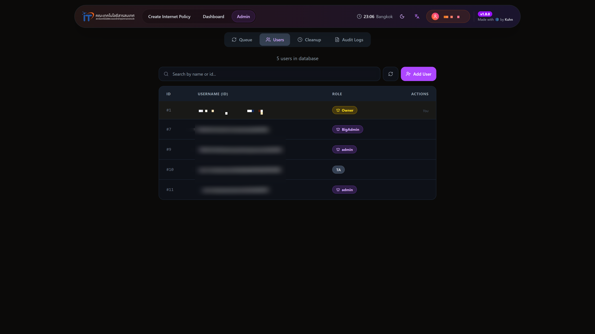
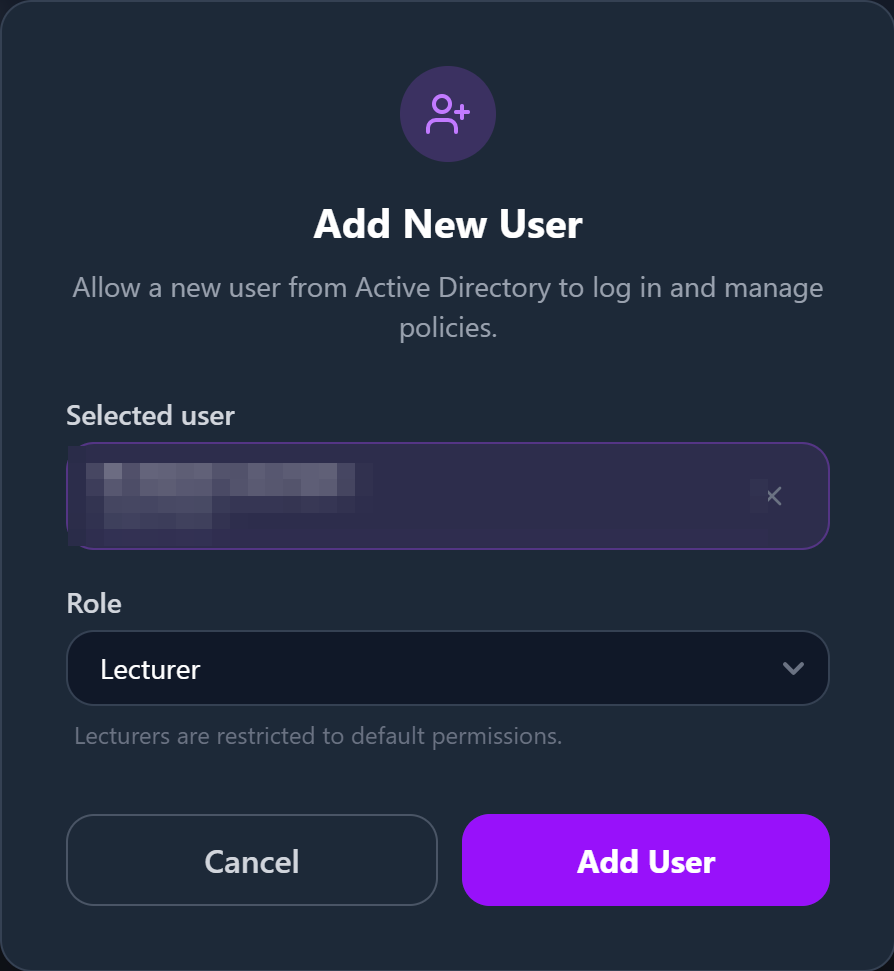
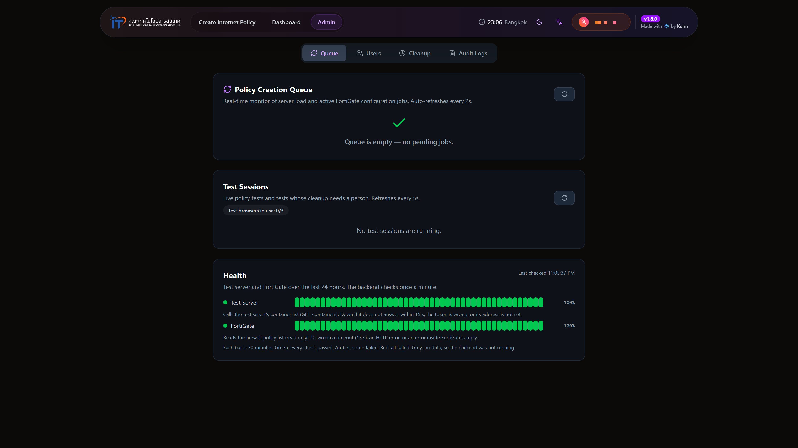
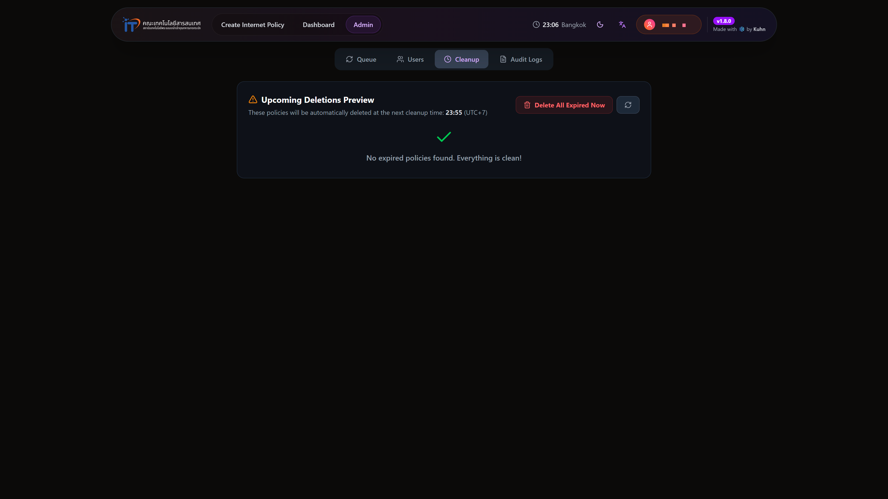
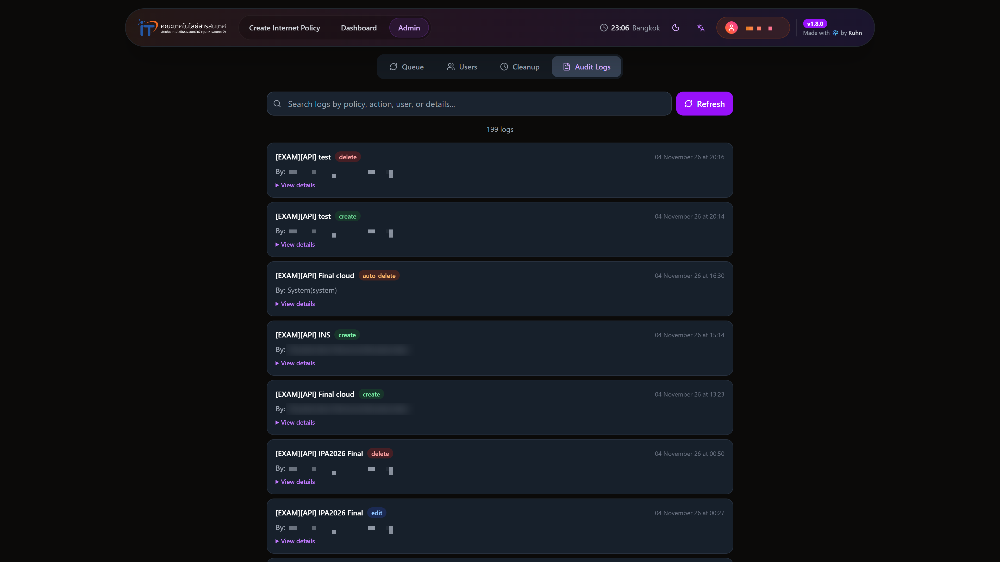
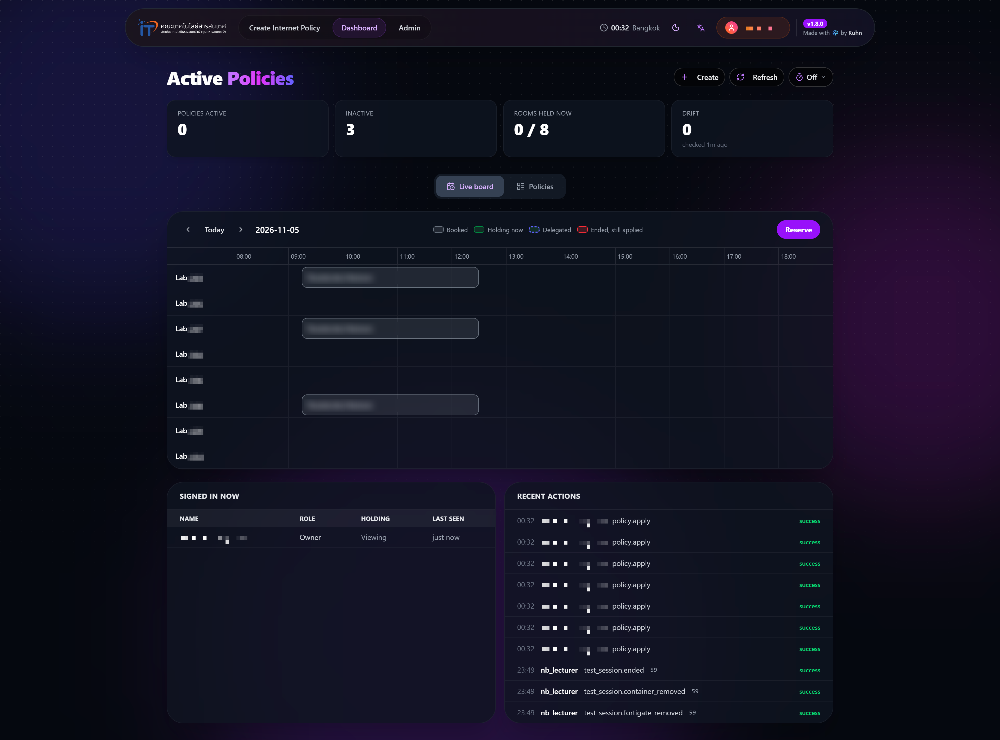
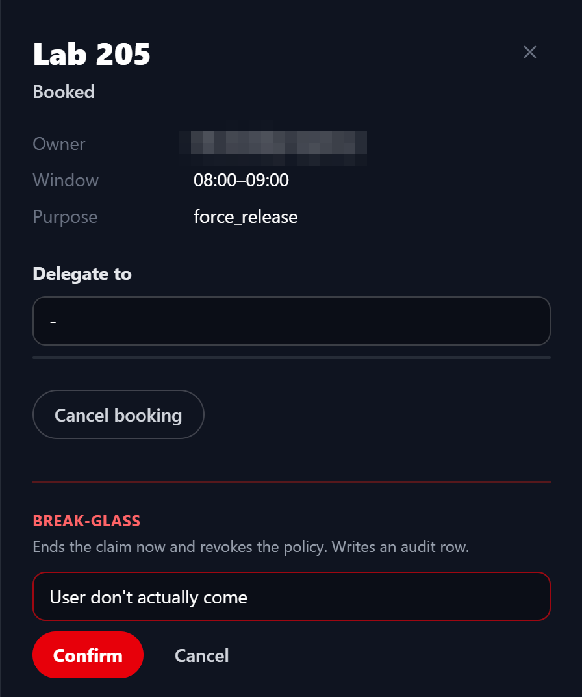

# คู่มือสำหรับผู้ดูแลระบบและการติดตั้ง

คู่มือนี้แบ่งเป็นสองส่วน ส่วนแรกคือหัวข้อ 1 ถึง 6 อธิบายงานของผู้ดูแลระบบผ่านหน้าเว็บ ซึ่งต่อจาก[คู่มือการใช้งานสำหรับผู้ใช้](user-manual.md) ส่วนที่สองคือหัวข้อ 7 ถึง 11 อธิบายการติดตั้งและการตั้งค่าระบบ สำหรับฝ่ายสารสนเทศที่รับช่วงดูแลระบบต่อ

## สารบัญ

**ส่วนที่ 1 งานของผู้ดูแลระบบ**

1. สิทธิ์ของผู้ดูแลระบบ
2. การจัดการผู้ใช้
3. คิวงาน เซสชันทดสอบ และสถานะระบบ
4. การลบนโยบายที่หมดเวลา
5. บันทึกการแก้ไขนโยบาย
6. งานบนกระดาน

**ส่วนที่ 2 การติดตั้งและการตั้งค่า**

7. องค์ประกอบของระบบ
8. ค่าตั้งค่าของระบบ
9. การติดตั้งฐานข้อมูล
10. การนำส่งระบบ
11. การติดตั้งเครื่องทดสอบ

---

# ส่วนที่ 1 งานของผู้ดูแลระบบ

## 1. สิทธิ์ของผู้ดูแลระบบ

ผู้ดูแลระบบคือผู้ใช้ที่มีบทบาทที่มีคำว่า admin ซึ่งกำหนดในแท็บผู้ใช้ตามหัวข้อ 2 ผู้ดูแลทำได้ทุกอย่างที่ผู้ใช้ทั่วไปทำได้ กับนโยบายของผู้ใช้ทุกคน และเข้าหน้า **Admin Panel** ได้ ระบบอ่านบทบาทจากฐานข้อมูลใหม่ทุกคำขอ การเปลี่ยนบทบาทจึงมีผลทันทีโดยผู้ใช้ไม่ต้องเข้าสู่ระบบใหม่ แม้ผู้ดูแลจะแก้ไขนโยบายได้ทุกนโยบาย แต่ก็ต้องถือการจองของห้องนั้นเช่นเดียวกับผู้ใช้ทั่วไป

## 2. การจัดการผู้ใช้

1. ใน Admin Panel เลือกแท็บ **Users** แล้วกด **Add User**

   
   *แท็บผู้ใช้และบทบาท*

2. ค้นหาผู้ใช้ด้วยรหัสหรือชื่อ แล้วเลือกผู้ใช้จากผลการค้นหา
3. เลือกบทบาท Admin, TA, Lecturer หรือ Other แล้วกด **Add User**

   

   *หน้าต่างเพิ่มผู้ใช้เมื่อเลือกผู้ใช้และบทบาทแล้ว*

4. การถอนสิทธิ์ทำได้ด้วยปุ่มลบในแถวของผู้ใช้ ผู้ใช้นั้นจะเข้าสู่ระบบไม่ได้อีก

อาจารย์และเจ้าหน้าที่ฝ่ายสารสนเทศเข้าใช้ระบบได้จากกลุ่มของตนในระบบยืนยันตัวตนของคณะ โดยไม่ต้องเพิ่มชื่อ แท็บนี้จึงใช้เป็นหลักสำหรับเพิ่มนักศึกษา ซึ่งต้องเพิ่มก่อนที่อาจารย์จะมอบสิทธิ์ให้ตามหัวข้อ 6 ของ[คู่มือผู้ใช้](user-manual.md)

## 3. คิวงาน เซสชันทดสอบ และสถานะระบบ

แท็บ **Queue** มีสามส่วน

1. **Policy Creation Queue** แสดงงานสร้างนโยบายในสถานะ WAITING, PROCESSING, COMPLETED หรือ FAILED งานที่จบแล้วถูกลบออกจากรายการเองหลัง 5 นาที และคิวหายไปเมื่อ Backend เริ่มทำงานใหม่
2. **Test Sessions** แสดงเซสชันทดสอบที่กำลังทำงาน และจำนวนเบราว์เซอร์ทดสอบที่ใช้อยู่เทียบกับขีดจำกัด ปรับทุก 5 วินาที ผู้ดูแลจบเซสชันใดก็ได้ด้วยปุ่ม **End** เซสชันที่อยู่ในสถานะ Stuck คือเซสชันที่ระบบลบ object ทดสอบไม่สำเร็จ ให้ตรวจ object บนอุปกรณ์ FortiGate ด้วยตนเองก่อนกด **Retry**
3. **Health** แสดงผลการตรวจเครื่องทดสอบและอุปกรณ์ FortiGate ย้อนหลัง 24 ชั่วโมง Backend ตรวจทุกนาที แต่ละแท่งแทนช่วง 30 นาที สีเขียวคือผ่านทุกครั้ง สีเหลืองคือผ่านบางครั้ง สีแดงคือไม่ผ่านเลย และสีเทาคือไม่มีข้อมูล ซึ่งหมายถึง Backend ไม่ได้ทำงานในช่วงนั้น

*คิวงาน เซสชันทดสอบ และสถานะระบบ*

## 4. การลบนโยบายที่หมดเวลา

ระบบลบนโยบายที่ตารางเวลาสิ้นสุดแล้วโดยอัตโนมัติทุกชั่วโมงที่นาทีที่ 55 แท็บ **Cleanup** แสดงรายการนโยบายที่จะถูกลบในรอบถัดไปและเวลาของรอบถัดไป ผู้ดูแลสั่งลบทันทีได้ด้วยปุ่ม **Delete All Expired Now** ซึ่งต้องยืนยันก่อน และย้อนกลับไม่ได้

*นโยบายที่จะถูกลบในรอบถัดไป*

## 5. บันทึกการแก้ไขนโยบาย

แท็บ **Audit Logs** แสดงประวัติการสร้าง แก้ไข และลบนโยบาย ทั้งที่ผู้ใช้ทำและที่ระบบทำ รวมถึงการสร้างที่ล้มเหลว ค้นหาได้ด้วยชื่อนโยบาย การกระทำ ผู้ใช้ หรือรายละเอียด

*บันทึกการแก้ไขนโยบาย*

## 6. งานบนกระดาน

ผู้ดูแลเห็นแผง **Signed in now** และ **Recent actions** ใต้กระดาน และมีงานเพิ่มเติมสองอย่าง

*กระดานที่ผู้ดูแลเห็น พร้อมแผงผู้ใช้ที่เปิดอยู่และกิจกรรมล่าสุด*

1. ค่า **Drift** บนแถบสถานะคือจำนวน object บนอุปกรณ์ที่ไม่มีการจองรองรับ ระบบตรวจทุก 5 นาที และผู้ดูแลกด **Reconcile now** เพื่อตรวจทันทีได้
2. ในแผงรายละเอียดของการจองใดก็ได้ ผู้ดูแลกด **Force-release** เพื่อยุติการจองทันทีและเพิกถอนนโยบายของห้องนั้น ต้องกรอกเหตุผลแล้วกด **Confirm** และระบบบันทึกการกระทำนี้ในบันทึกการตรวจสอบ ใช้เมื่อจำเป็น เช่น ผู้จองไม่อยู่และห้องต้องกลับมาใช้อินเทอร์เน็ตได้

   

   *แผงรายละเอียดของการจองขณะผู้ดูแลกรอกเหตุผลของ Force-release*

---

# ส่วนที่ 2 การติดตั้งและการตั้งค่า

## 7. องค์ประกอบของระบบ

ระบบประกอบด้วยสี่คอนเทนเนอร์ที่ทำงานด้วย Docker Compose บนเครื่องแม่ข่ายเดียวกับ SupportHub ได้แก่ Frontend (SvelteKit) Backend (Bun และ ElysiaJS) ฐานข้อมูล PostgreSQL และ Nginx และเครื่องเสมือนทดสอบอีกหนึ่งเครื่องสำหรับสภาพแวดล้อมทดสอบนโยบาย ระบบต้องการสิ่งต่อไปนี้จากภายนอก

1. API token ของผู้ดูแลแบบ REST API บนอุปกรณ์ FortiGate
2. แอปพลิเคชันแบบ OIDC บน Authentik ของคณะ และ API token สำหรับค้นหาผู้ใช้
3. VLAN สำหรับทดสอบที่มี DHCP และออกอินเทอร์เน็ตผ่านอุปกรณ์ FortiGate และ virtual switch ของเครื่องเสมือนทดสอบที่ตั้งให้ยอมรับ MAC address ของคอนเทนเนอร์ (Promiscuous mode, MAC address changes และ Forged transmits เป็น Accept)

## 8. ค่าตั้งค่าของระบบ

ค่าตั้งค่าเก็บในไฟล์ `.env` บนเครื่องแม่ข่าย ไม่เก็บใน repository ตารางนี้แสดงเฉพาะชื่อและหน้าที่ของค่า ตัวเลขในวงเล็บคือค่าเริ่มต้น

| ชื่อ | หน้าที่ |
|---|---|
| **Backend** | |
| `FGT_IP`, `API_TOKEN` | ที่อยู่ของอุปกรณ์ FortiGate และ API token |
| `JWT_SECRET` | กุญแจลงนามโทเคนเข้าสู่ระบบ |
| `OIDC_ISSUER`, `OIDC_CLIENT_ID`, `OIDC_CLIENT_SECRET` | การเชื่อมต่อ OIDC กับ Authentik |
| `AUTHENTIK_URL`, `AUTHENTIK_API_KEY`, `STUDENT_GROUP_PK` | การค้นหาผู้ใช้จาก Authentik เมื่อเพิ่มผู้ใช้และมอบสิทธิ์ |
| `DATABASE_URL` | การเชื่อมต่อฐานข้อมูล |
| `RESERVATION_ENFORCE` | ปฏิเสธคำขอแก้ไขนโยบายจากผู้ที่ไม่ถือการจอง ค่าเริ่มต้นปิด ระบบจริงเปิดอยู่ |
| `MAX_RESERVATION_HOURS`, `MAX_ADVANCE_DAYS` | ความยาวสูงสุดของการจอง (4 ชั่วโมง) และการจองล่วงหน้าสูงสุด (30 วัน) |
| `EXPIRY_SWEEP_SECONDS`, `RECONCILE_INTERVAL_SECONDS` | รอบของงานเพิกถอน (30 วินาที) และงานตรวจ object (300 วินาที) |
| `PRESENCE_WINDOW_MINUTES`, `AUDIT_RETENTION_DAYS` | ช่วงที่นับว่าผู้ใช้ยังเปิดหน้าจออยู่ (5 นาที) และอายุของบันทึกการตรวจสอบ (90 วัน) |
| `TEST_SESSIONS_ENABLED` | เปิดสภาพแวดล้อมทดสอบนโยบาย |
| `TEST_HELPER_URL`, `TEST_HELPER_TOKEN` | ที่อยู่ของบริการบนเครื่องทดสอบและโทเคนที่ใช้ร่วมกัน |
| `TEST_SRCINTF`, `TEST_CLIENT_SUBNET` | interface และ subnet ของ VLAN ทดสอบบนอุปกรณ์ |
| `TEST_NAME_PREFIX` | คำนำหน้าชื่อ object ทดสอบ ห้ามเปลี่ยนขณะมีเซสชันทดสอบค้างอยู่ |
| `MAX_ACTIVE_TEST_SESSIONS`, `SANDBOX_SESSION_MINUTES` | จำนวนเซสชันพร้อมกันสูงสุด (3) และความยาวของเซสชัน (20 นาที) |
| **Frontend** | |
| `PUBLIC_BACKEND_URL` | ที่อยู่ของ Backend ภายในเครือข่ายของ Docker |
| `OIDC_ISSUER`, `OIDC_CLIENT_ID` | การเริ่มเข้าสู่ระบบกับ Authentik |
| `SLUG_SECRET` | กุญแจเข้ารหัสลิงก์หน้ารายละเอียดของนโยบาย เป็นเลขฐานสิบหก 64 ตัว |
| **บริการบนเครื่องทดสอบ** | |
| `TEST_HELPER_TOKEN` | ค่าเดียวกับของ Backend ยาวอย่างน้อย 32 ตัวอักษร |
| `TEST_PARENT_IF`, `TEST_HELPER_BIND`, `TEST_HELPER_PORT` | การ์ดเครือข่ายที่คอนเทนเนอร์ใช้ ที่อยู่และพอร์ตที่บริการรับคำขอ |

## 9. การติดตั้งฐานข้อมูล

ตารางรุ่นแรกสร้างจาก schema ของ Drizzle ORM ส่วนตารางของการจอง การมอบสิทธิ์ บันทึกการตรวจสอบ และเซสชันทดสอบอยู่ในไฟล์ SQL แยก เพราะใช้ tstzrange เงื่อนไขการยกเว้น และ view ซึ่ง Drizzle ORM สร้างไม่ได้

1. สำรองฐานข้อมูลด้วย `pg_dump` ก่อนเปลี่ยน schema ทุกครั้ง
2. รัน `bun run migrate:reservations` ทุกคำสั่งในไฟล์มีเงื่อนไขตรวจก่อนสร้าง จึงรันซ้ำได้โดยไม่เกิดผล การรันครั้งแรกต้องใช้บัญชี superuser เพื่อเปิดส่วนขยาย `btree_gist`
3. ใส่แม่แบบของระบบด้วย `bun run seed-ordered.ts`

ห้ามรัน `drizzle-kit migrate` กับฐานข้อมูลที่ใช้งานจริง เพราะฐานข้อมูลไม่มีประวัติ migration ของ Drizzle คำสั่งจะพยายามสร้างตารางที่มีอยู่แล้วซ้ำ การเพิ่มตารางใหม่ให้เขียนเป็นคำสั่ง SQL ที่มีเงื่อนไข `IF NOT EXISTS` แบบเดียวกับไฟล์ข้างต้น

## 10. การนำส่งระบบ

เมื่อ push หรือรวม pull request เข้าสาขา main ของ repository ใด เวิร์กโฟลว์ GitHub Actions บน self-hosted runner ของเครื่องแม่ข่ายสร้างอิมเมจของบริการนั้นใหม่ด้วย `docker compose up --build -d --no-deps` แล้วลบอิมเมจเก่าที่ไม่ใช้ บริการอื่นไม่ถูกเริ่มใหม่ การเปลี่ยนค่าใน `.env` ต้องเริ่มคอนเทนเนอร์ของบริการนั้นใหม่จึงมีผล

## 11. การติดตั้งเครื่องทดสอบ

1. ติดตั้ง Docker Engine, Bun และแพ็กเกจ iproute2, util-linux, procps และ busybox-static บนเครื่องเสมือนทดสอบ
2. ทดสอบด้วยมือว่าคอนเทนเนอร์ได้ที่อยู่จาก DHCP ของ VLAN ทดสอบ ก่อนติดตั้งบริการ
3. สร้างอิมเมจเบราว์เซอร์ทดสอบจาก linuxserver/firefox โดยเพิ่มใบรับรองของอุปกรณ์ FortiGate ที่ใช้ตรวจ HTTPS แล้วตรึงอิมเมจด้วยรหัสของอิมเมจ บริการไม่ยอมเริ่มทำงานถ้าอิมเมจยังไม่ถูกตรึง
4. ติดตั้งบริการเป็น systemd service ที่ทำงานด้วยสิทธิ์ root ตั้ง `KillMode=process` เพื่อให้คอนเทนเนอร์ที่ทำงานอยู่ไม่เสียที่อยู่เมื่อบริการเริ่มใหม่
5. ตั้งไฟร์วอลล์ของเครื่องให้รับคำขอที่พอร์ตของบริการจาก Backend เท่านั้น
6. ตั้งค่า `TEST_*` ของ Backend และเปิด `TEST_SESSIONS_ENABLED` แล้วตรวจแถบ Health ในแท็บ Queue ว่าเครื่องทดสอบเป็นสีเขียว
