# คู่มือการใช้งานสำหรับผู้ใช้

คู่มือนี้อธิบายขั้นตอนการใช้งาน Netblocker รุ่น 1.8.0 สำหรับอาจารย์และเจ้าหน้าที่ที่ใช้ระบบควบคุมการเข้าถึงอินเทอร์เน็ตในห้องปฏิบัติการ หน้าจอของระบบเป็นภาษาอังกฤษ ชื่อปุ่มและเมนูในคู่มือนี้จึงเขียนตามที่ปรากฏบนหน้าจอ ส่วนงานของผู้ดูแลระบบอธิบายไว้ใน[คู่มือสำหรับผู้ดูแลระบบและการติดตั้ง](admin-manual.md)

## สารบัญ

1. การเข้าสู่ระบบ
2. การจองห้อง
3. การสร้างนโยบาย
4. การแก้ไขและลบนโยบาย
5. แม่แบบส่วนตัว
6. การมอบหมายสิทธิ์
7. การทดสอบนโยบาย

## 1. การเข้าสู่ระบบ

ผู้ที่เข้าใช้ระบบได้คืออาจารย์และเจ้าหน้าที่ฝ่ายสารสนเทศของคณะ และผู้ใช้ที่ผู้ดูแลระบบเพิ่มชื่อไว้ เช่น นักศึกษาที่ต้องเข้าใช้ระบบ

1. เปิดหน้าแรกของระบบแล้วกด **Get Started - Login**
2. ระบบพาไปยังหน้าเข้าสู่ระบบของคณะ ให้เข้าสู่ระบบด้วยบัญชีของคณะ
3. เมื่อเข้าสู่ระบบสำเร็จ ระบบพาไปยังหน้าแดชบอร์ด ถ้าบัญชีไม่มีสิทธิ์เข้าใช้ ระบบแสดงหน้าแจ้งว่าไม่มีสิทธิ์ ให้ติดต่อผู้ดูแลระบบ

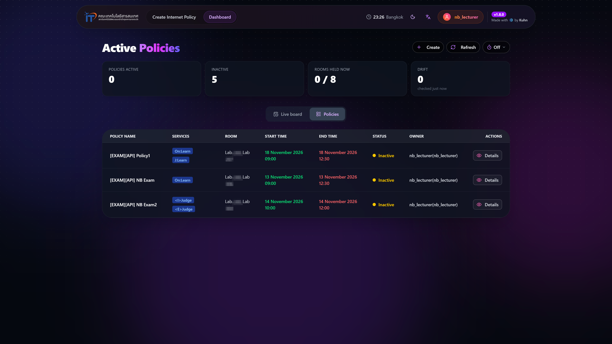
*หน้าแดชบอร์ดแสดงรายการนโยบายของผู้ใช้*

การเข้าสู่ระบบแต่ละครั้งมีอายุ 8 ชั่วโมง

## 2. การจองห้อง

ผู้ใช้ต้องจองห้องก่อนสร้างหรือแก้ไขนโยบายของห้องนั้น

1. ในหน้าแดชบอร์ด เลือกแท็บ **Live board** แล้วกด **Reserve**

   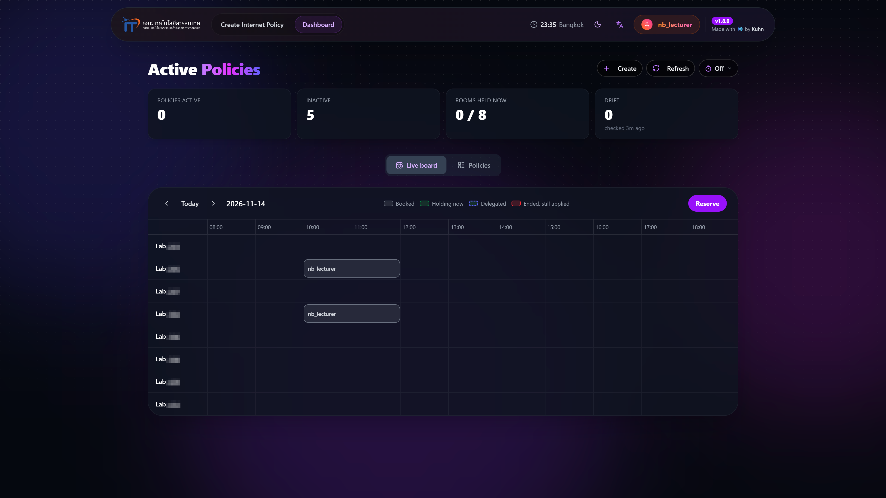
   *กระดานห้องกับเวลาที่ผู้ใช้ทั่วไปเห็น*

2. เลือกห้อง (Rooms) ซึ่งเลือกได้หลายห้อง วันที่ (Date) เวลาเริ่ม (Start) และเวลาสิ้นสุด (End) และกรอกวัตถุประสงค์ (Purpose) ได้ถ้าต้องการ ข้อความนี้แสดงบนกระดานและในบันทึกการตรวจสอบ
3. ตรวจสรุปในส่วน **What will happen** ซึ่งบอกว่าแต่ละห้องจะถูกจองใหม่ จะปรับเวลาของการจองเดิมของผู้ใช้ หรือมีผู้อื่นจองไว้แล้ว

   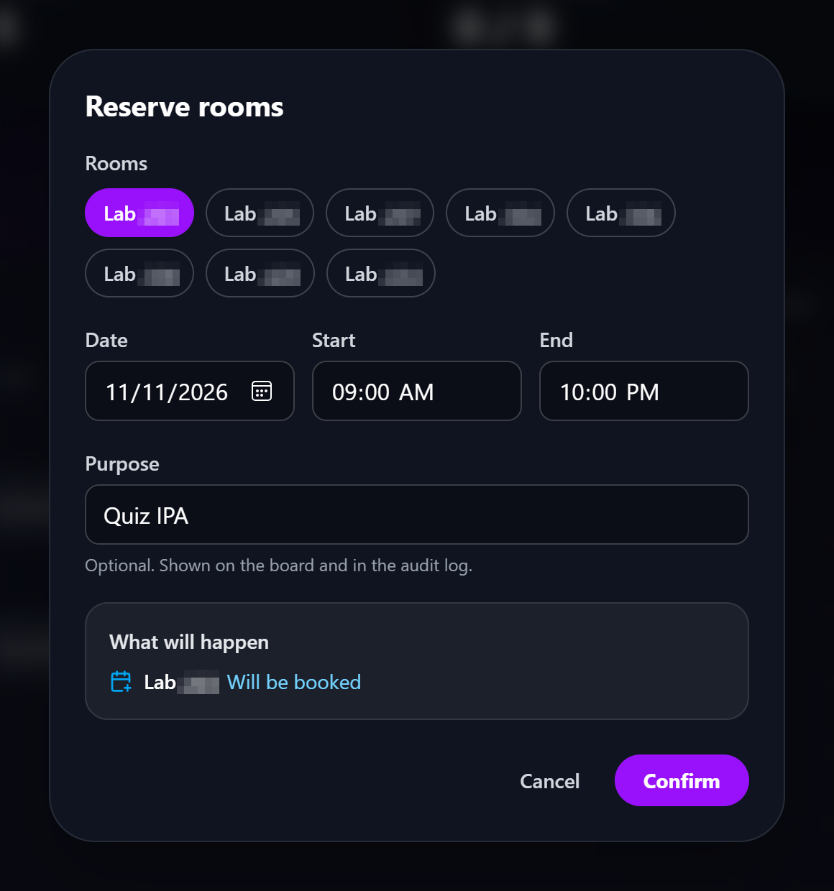

   *หน้าต่างจองห้อง*

4. กด **Confirm**

ถ้าช่วงเวลาซ้อนกับการจองของผู้อื่น ระบบปฏิเสธการจองและแสดงลิงก์ **See the existing booking** ไปยังการจองเดิม

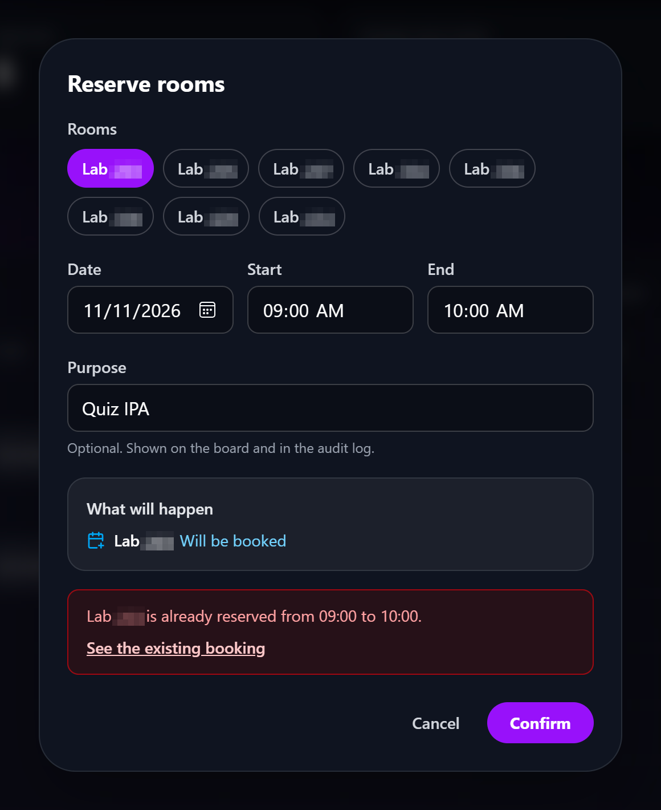

*ข้อความปฏิเสธเมื่อจองห้องซ้อนทับการจองที่มีอยู่*

การยกเลิกการจองทำได้โดยคลิกแถบการจองบนกระดานแล้วกด **Cancel booking** ซึ่งทำได้เฉพาะเจ้าของการจองและก่อนเวลาเริ่มของการจองเท่านั้น

## 3. การสร้างนโยบาย

1. กด **Create Internet Policy** ที่แถบด้านบน
2. ในส่วน **1. Policy Details** ตั้งชื่อนโยบายด้วยอักษรภาษาอังกฤษ ตัวเลข หรือช่องว่าง ยาวไม่เกิน 17 ตัวอักษร แล้วเลือกห้อง ซึ่งเลือกได้หลายห้อง
3. ในส่วน **2. Schedule** เลือกวันที่ เวลาเริ่ม และเวลาสิ้นสุด กล่อง **Room reservations** แสดงสถานะการจองของแต่ละห้องที่เลือก ถ้ายังจองไม่ครบ กด **Reserve these rooms** เพื่อจองจากหน้านี้ได้ทันที
4. ในส่วน **3. Services** เลือก **Block Mode** เพื่อปิดกั้นทุกเว็บไซต์ยกเว้นบริการที่เลือก หรือ **Pass Mode** เพื่อเปิดทุกเว็บไซต์และปิดกั้นเฉพาะบริการที่เลือก แล้วเลือกบริการจากแม่แบบของระบบ (System Templates) หรือแม่แบบส่วนตัว (My Templates)

   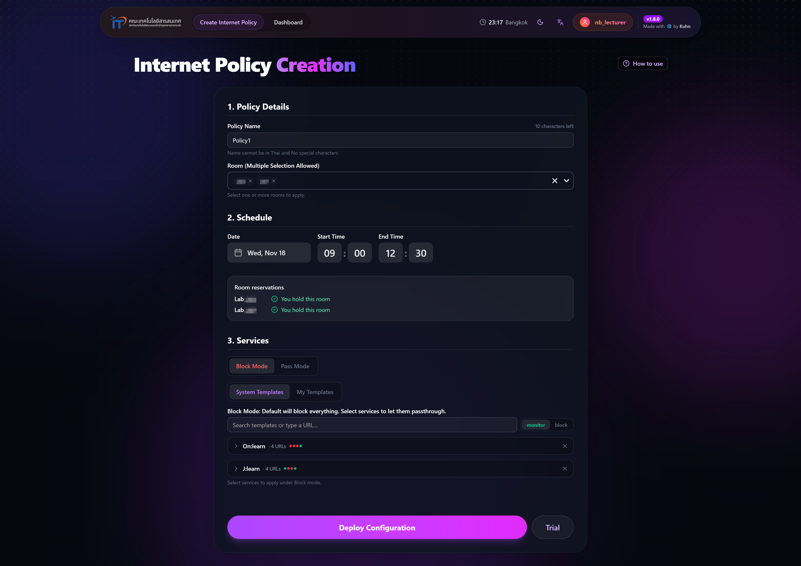
   *หน้าสร้างนโยบายเมื่อเลือกแม่แบบแล้ว*

5. ถ้าต้องการลองร่างนโยบายก่อนสร้างจริง กด **Trial** ระบบเปิดเบราว์เซอร์ทดสอบด้วยกลไกเดียวกับหัวข้อ 7 ในหน้านี้เพิ่มหรือลบแม่แบบได้ เมื่อลองเสร็จ กด **End and create** เพื่อกลับไปหน้าสร้างนโยบายพร้อมแม่แบบที่แก้แล้ว หรือกด **Cancel trial** เพื่อกลับไปโดยใช้ร่างเดิม Trial ใช้ได้กับแม่แบบของระบบเท่านั้น

   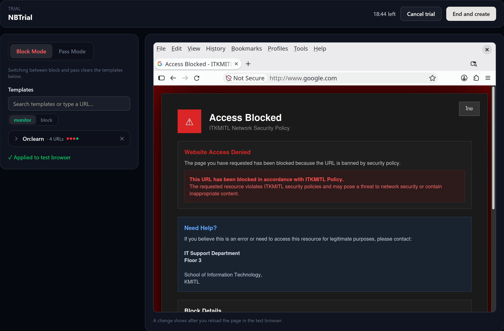
   *หน้า Trial ขณะเบราว์เซอร์ทดสอบเปิดเว็บไซต์ที่ไม่อยู่ในรายการอนุญาต*

6. กด **Deploy Configuration** คำขอเข้าคิว และหน้าจอแสดงลำดับในคิวจนสร้างเสร็จ แล้วแสดงสรุปชื่อนโยบาย ห้อง และโหมด

   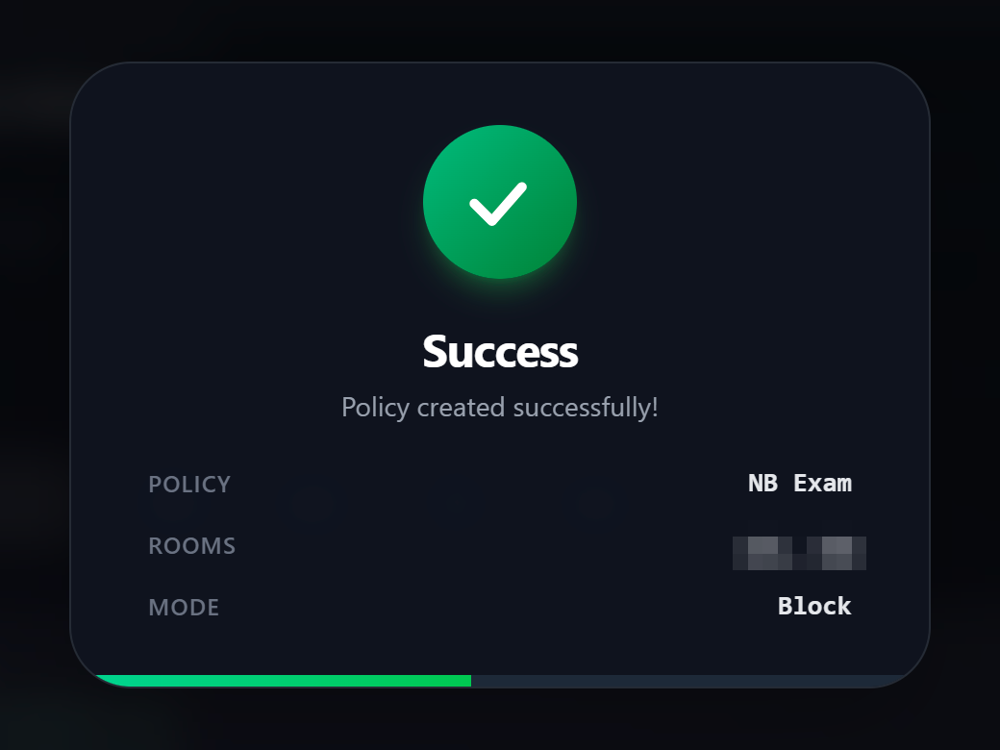

   *หน้าต่างแจ้งผลเมื่อสร้างนโยบายสำเร็จ*

ระบบไม่สร้างนโยบายเมื่อชื่อซ้ำกับนโยบายที่มีอยู่ หรือเมื่อห้องและช่วงเวลาซ้อนกับนโยบายอื่น และแจ้งเหตุผลให้ผู้ใช้ทราบ

## 4. การแก้ไขและลบนโยบาย

1. ในแท็บ **Policies** ของแดชบอร์ด เลือกนโยบายเพื่อเปิดหน้ารายละเอียด

   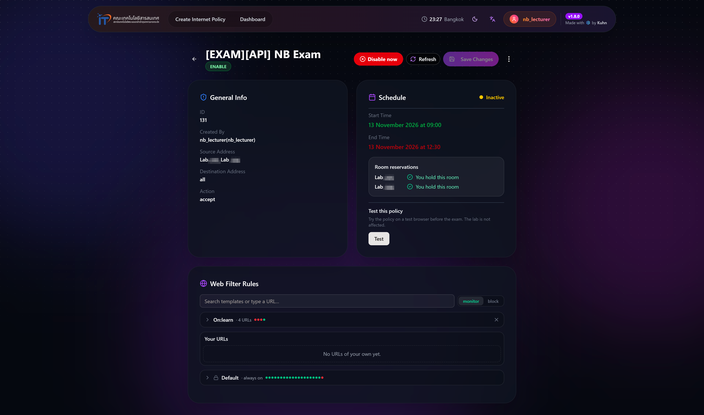
   *หน้ารายละเอียดของนโยบายและตัวแก้กฎด้านล่าง*

2. แก้รายการเว็บไซต์ในตัวแก้กฎด้านล่างของหน้า โดยพิมพ์ชื่อแม่แบบหรือ URL ในช่องค้นหา กำหนดว่าแต่ละรายการจะอนุญาตพร้อมบันทึกการเข้าใช้ (monitor) หรือปิดกั้น (block) แล้วกด **Save Changes** ถ้าเพิ่มรายการที่มีอยู่แล้ว ระบบเตือนและบอกกลุ่มที่รายการนั้นอยู่

   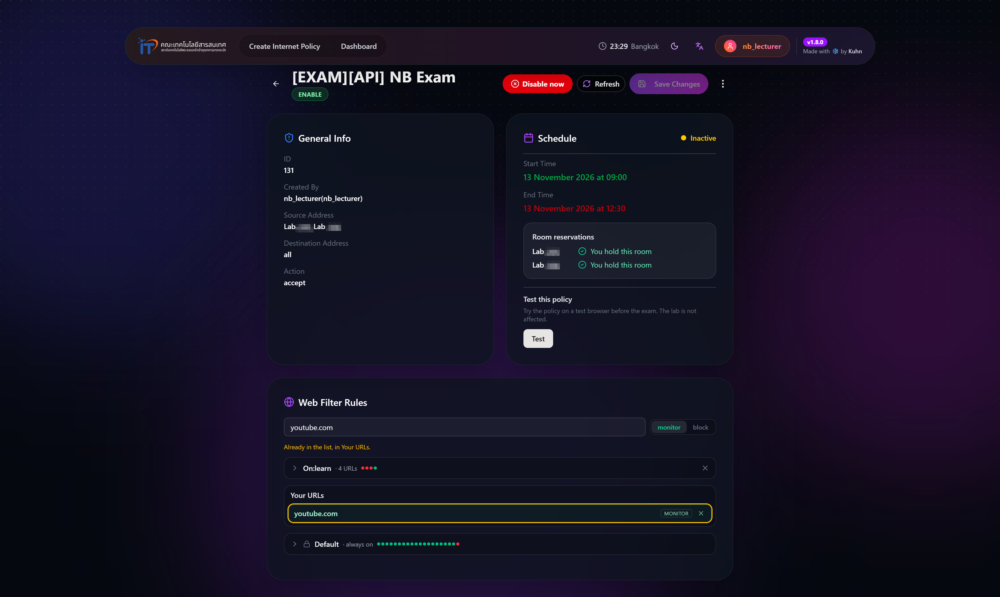
   *คำเตือนเมื่อเพิ่ม URL ที่มีอยู่ในรายการแล้ว*

3. แก้ห้องหรือช่วงเวลาด้วยเมนู **Edit Policy** แล้วกด **Save Changes** ระบบแสดงสรุปให้ยืนยันก่อนบันทึก
4. บันทึกรายการเว็บไซต์ของนโยบายเป็นแม่แบบส่วนตัวด้วยเมนู **Save as template**
5. ลบนโยบายด้วยเมนู **Delete Policy** ระบบลบ object ทั้งสี่ชิ้นของนโยบายออกจากอุปกรณ์

เมนูแก้ไขและลบใช้ได้เมื่อผู้ใช้ถือการจองครบทุกห้องของนโยบายในช่วงเวลาของนโยบาย ถ้าถือไม่ครบ หน้าจอแสดงห้องที่ยังไม่ได้จองพร้อมปุ่ม **Reserve these rooms** ผู้ใช้ทั่วไปแก้ไขและลบได้เฉพาะนโยบายที่ตนสร้าง

| ถือการจองไม่ครบ เมนูแก้ไขและลบถูกปิด | ถือการจองครบทุกห้อง |
|---|---|
| 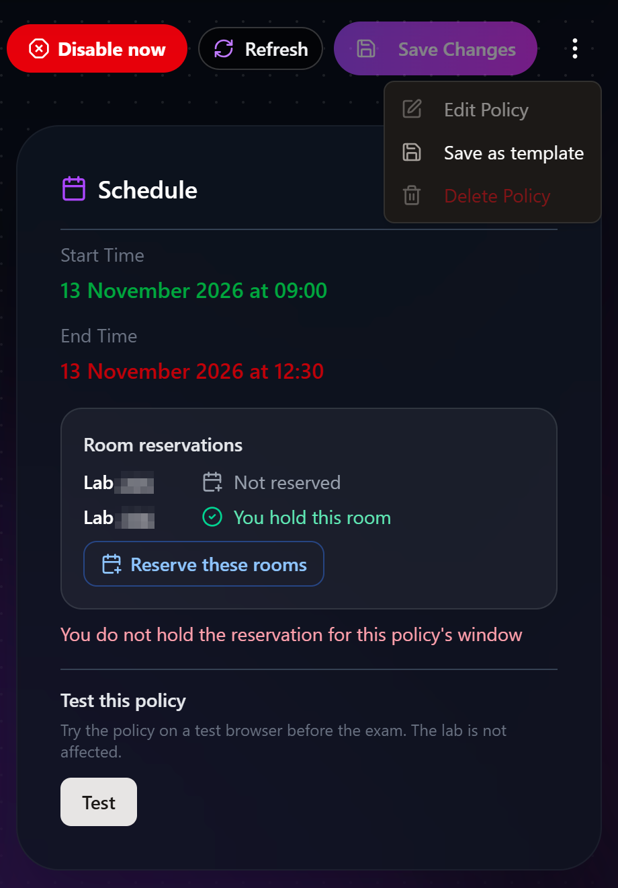 | 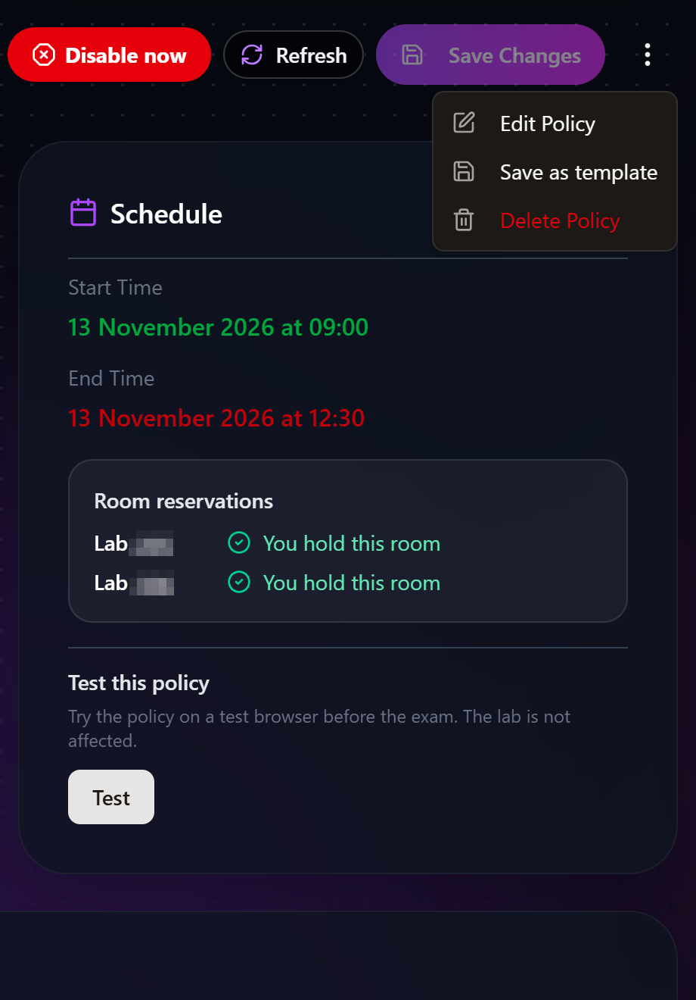 |

*หน้ารายละเอียดของนโยบายเมื่อผู้ใช้ถือการจองไม่ครบและครบ*

## 5. แม่แบบส่วนตัว

1. กด **Manage Templates** เพื่อเปิดหน้าแม่แบบ

   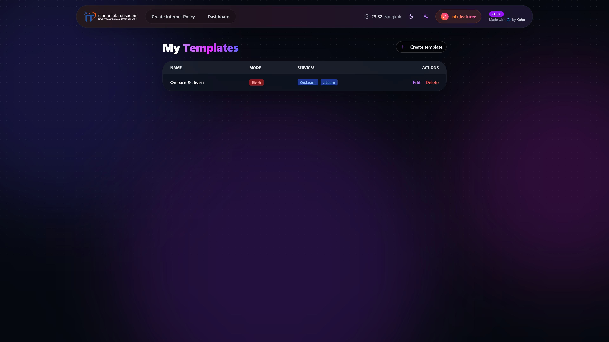
   *หน้าแม่แบบส่วนตัว*

2. กด **Create template** ตั้งชื่อ เลือกโหมด Pass หรือ Block และเลือกแม่แบบที่มีอยู่มารวมกัน แล้วกด **Create**

   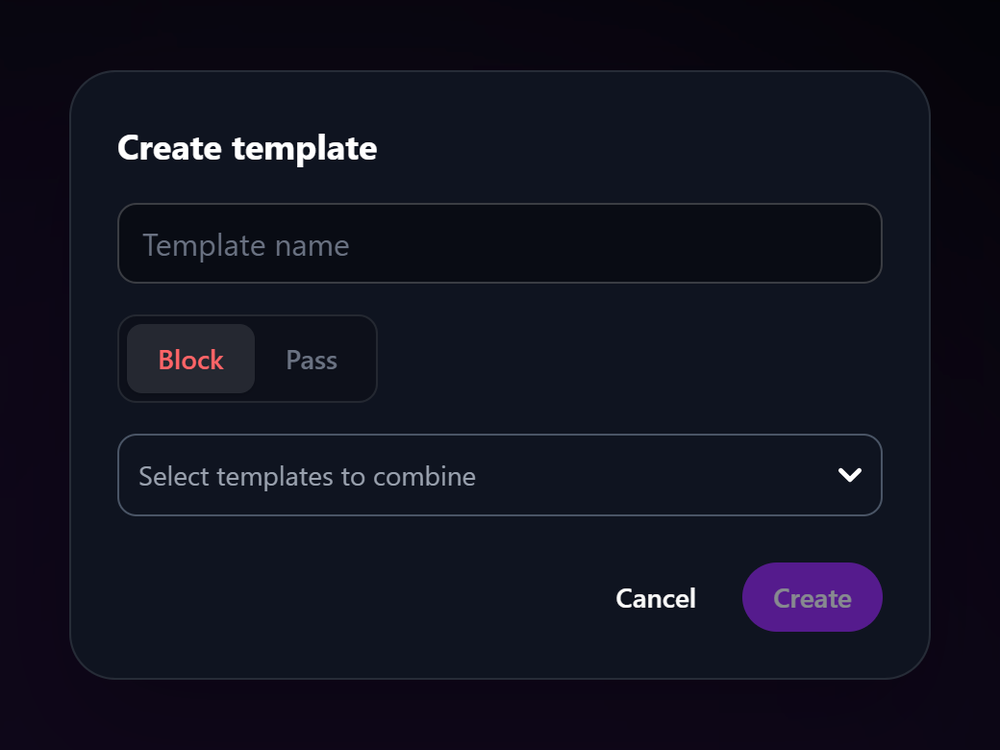

   *หน้าต่างสร้างแม่แบบส่วนตัวจากแม่แบบที่มีอยู่*

แม่แบบส่วนตัวเห็นได้เฉพาะเจ้าของ และใช้ได้ในส่วน My Templates ของหน้าสร้างนโยบาย

## 6. การมอบหมายสิทธิ์

1. ในแท็บ **Live board** คลิกแถบการจองของตน แผง **Reservation** จะแสดงรายละเอียดของการจอง

   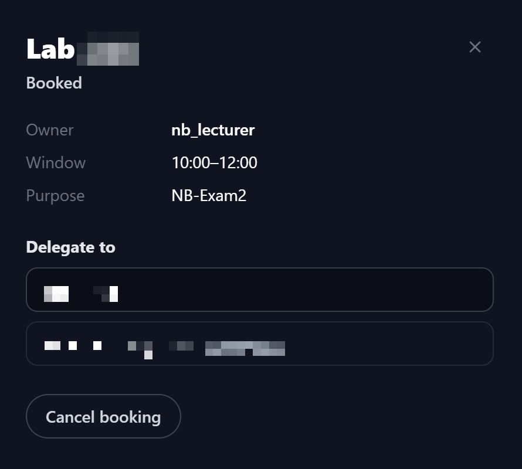

   *แผงรายละเอียดของการจองขณะค้นหาผู้รับมอบสิทธิ์*

2. ในส่วน **Delegate to** พิมพ์ชื่อหรือรหัสผู้ใช้ในช่อง **Filter people** เลือกผู้รับ แล้วกด **Delegate**
3. แถบการจองบนกระดานเปลี่ยนเป็นชื่อผู้รับมอบ ผู้รับมอบสร้างและแก้ไขนโยบายของห้องนั้นในช่วงเวลาของการจองได้ แต่มอบสิทธิ์ต่อให้ผู้อื่นไม่ได้
4. เจ้าของรับสิทธิ์คืนได้ด้วยปุ่ม **Take back control**

ผู้รับมอบต้องมีสิทธิ์เข้าใช้ระบบอยู่ก่อนตามหัวข้อ 1 มิฉะนั้นจะเข้าสู่ระบบเพื่อใช้สิทธิ์ที่ได้รับไม่ได้

## 7. การทดสอบนโยบาย

1. ในหน้ารายละเอียดของนโยบาย ที่กล่อง **Test this policy** กด **Test** แล้วกด **Start test**
2. หน้าทดสอบแสดงขั้นตอน Starting the test browser, Applying the test rule และ Ready ตามลำดับ

   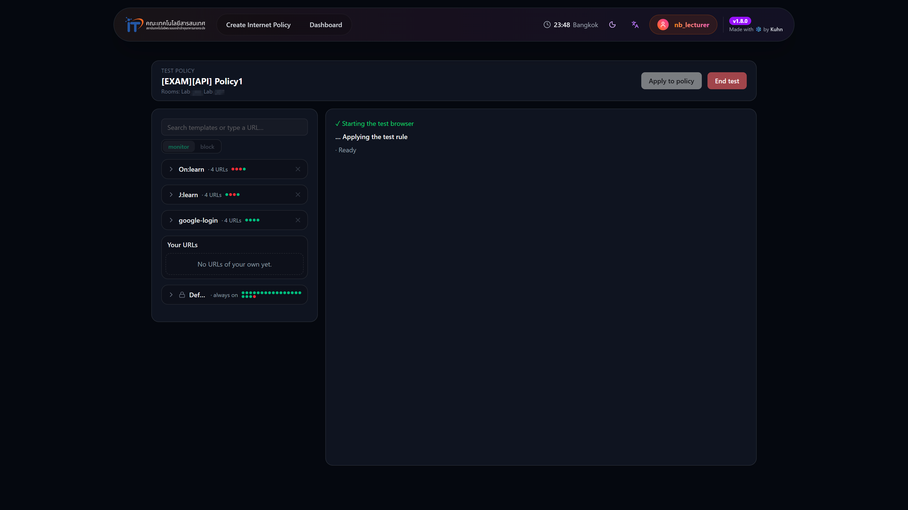
   *หน้าทดสอบนโยบายขณะเริ่มเซสชัน*

3. เมื่อพร้อม ด้านขวาของหน้าเป็นเบราว์เซอร์ทดสอบพร้อมเวลาที่เหลือ ซึ่งเริ่มที่ 20 นาที ให้เปิดเว็บไซต์ที่ต้องการตรวจ ด้านซ้ายเป็นตัวแก้กฎของการทดสอบ ซึ่งแก้ได้โดยไม่กระทบนโยบายจริง และการแก้ไขจะเห็นผลเมื่อโหลดหน้าในเบราว์เซอร์ทดสอบใหม่

   | onlearn.it.kmitl.ac.th | jlearn.it.kmitl.ac.th |
   |---|---|
   | 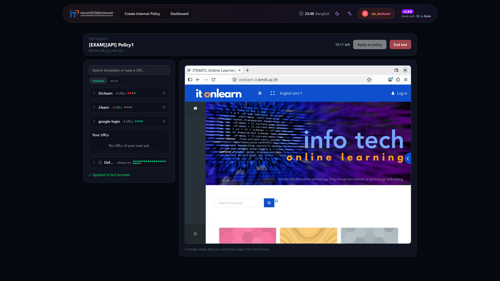 | 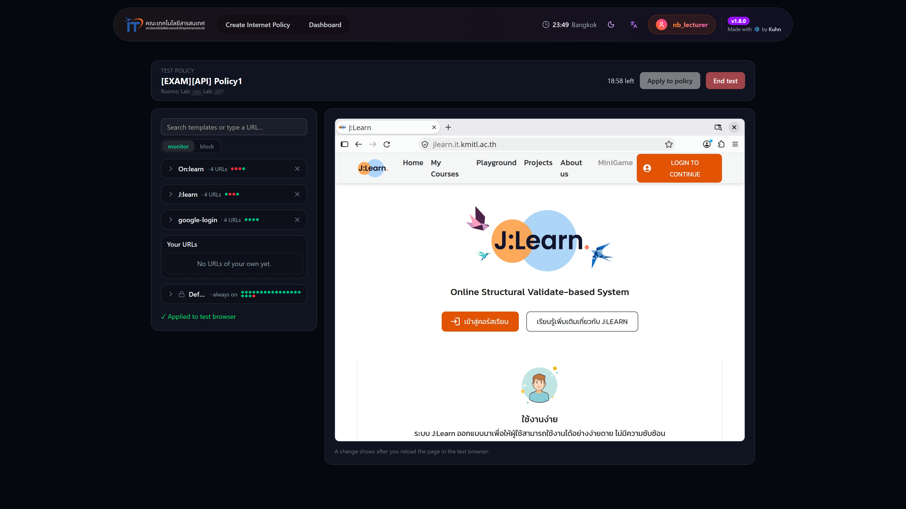 |

   *เว็บไซต์ในรายการอนุญาตเปิดได้ในเบราว์เซอร์ทดสอบ*

   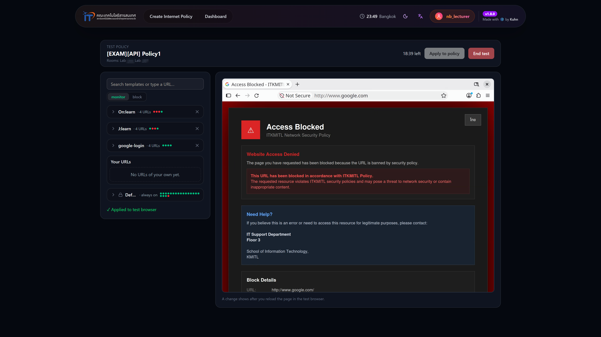
   *เว็บไซต์นอกรายการอนุญาตถูกปิดกั้นในเบราว์เซอร์ทดสอบ*

4. ถ้าต้องการใช้กฎที่แก้แล้วกับนโยบายจริง กด **Apply to policy**
5. กด **End test** เพื่อจบการทดสอบ ถ้ามีการแก้กฎที่ยังไม่ได้นำไปใช้ ระบบถามว่าจะ **Apply and end** หรือ **Discard and end**

การทดสอบไม่กระทบห้องปฏิบัติการ ผู้ทดสอบได้ต้องเป็นเจ้าของนโยบายหรือผู้ดูแล ผู้ใช้หนึ่งคนทดสอบได้ครั้งละหนึ่งเซสชัน และระบบรองรับการทดสอบพร้อมกันสูงสุดสามเซสชัน
